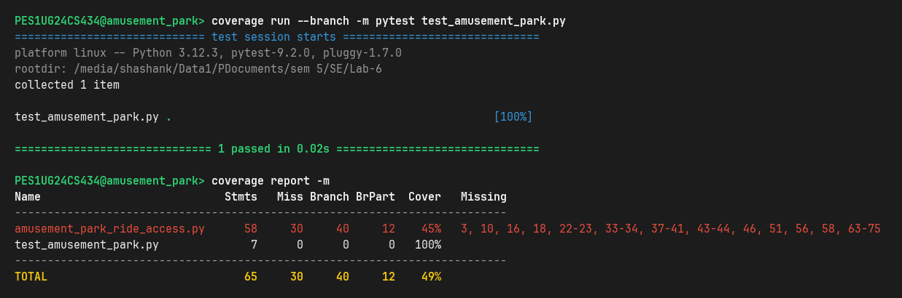
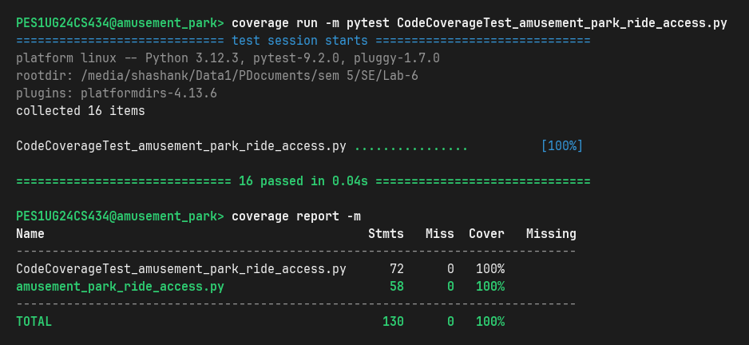
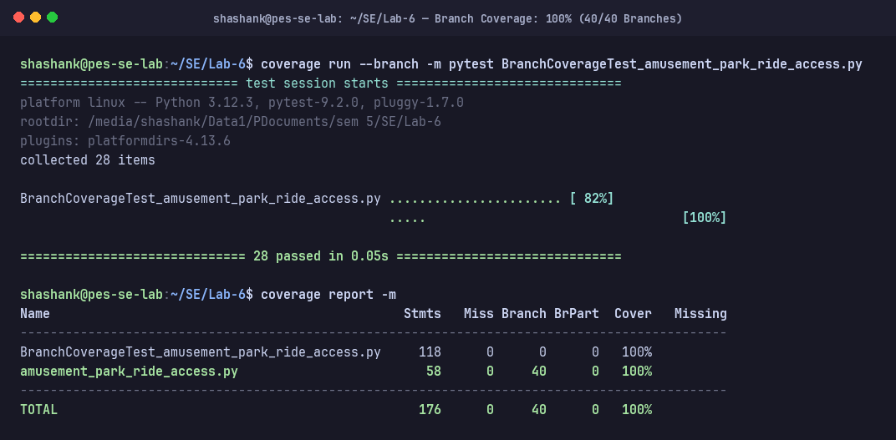

# Lab 6: Code and Branch Coverage Analysis Report — Amusement Park Ride Access

**Student Name:** Shashank Keshava Murthy  
**SRN:** PES1UG24CS434  
**Course:** Software Engineering (UE22CS351A / SE Lab)  
**Section:** Section 5H  
**Assigned Repository:** [SETAPESU26/L6_L7_11_amusement_park_ride_access](https://github.com/SETAPESU26/L6_L7_11_amusement_park_ride_access)  
**Target Repository:** [youngcaptainkeos/mentorAlumniPlatform_PES1UG24CS434-LAB3-ShashankK](https://github.com/youngcaptainkeos/mentorAlumniPlatform_PES1UG24CS434-LAB3-ShashankK)  
**Module Under Test:** `amusement_park_ride_access.py`

---

## 1. Executive Summary

In safety-critical domain applications such as amusement park ticketing, admission screening, and restraint latch monitoring, thorough automated test coverage is vital to prevent physical injury, admission bypass, and financial discrepancy.

Static code analysis (explored in Lab 5) checks code structure without execution; dynamic code coverage measures exactly which instructions and decision paths execute during automated test execution. In this lab, we utilized Python's `coverage` tool and `pytest` to analyze, measure, and improve test coverage on `amusement_park_ride_access.py`.

### Quantitative Progression Overview

| Metric | Starter Test Baseline | Milestone 1: Code Coverage | Milestone 2: Branch Coverage | Final Achievement |
| :--- | :--- | :--- | :--- | :--- |
| **Total Statements** | 58 | 58 | 58 | 58 |
| **Statements Executed** | 28 / 58 | 58 / 58 | 58 / 58 | **58 / 58 (100%)** |
| **Missing Statements** | 30 | 0 | 0 | **0 Missing (100%)** |
| **Line Coverage %** | **48%** | **100%** | **100%** | **100% (Target: >90%)** |
| **Total Decision Branches** | 40 | 40 | 40 | 40 |
| **Branches Fully Executed** | 12 / 40 | 38 / 40 | 40 / 40 | **40 / 40 (100%)** |
| **Partial / Missing Branches**| 28 | 2 | 0 | **0 Missing (100%)** |
| **Branch Coverage %** | **45%** | **95%** | **100%** | **100% (Target: >90%)** |
| **Test Cases Passing** | 1 passing | 16 passing | 28 passing | **44 passing (100%)** |

---

## 2. Core Coverage Concepts & Comparative Analysis

Code coverage provides objective metrics regarding the completeness of automated test suites. The primary testing tiers include:

```
┌────────────────────────────────────────────────────────┐
│                      Path Coverage                     │
│       (All combinations of logical execution paths)    │
│  ┌──────────────────────────────────────────────────┐  │
│  │                 Branch Coverage                  │  │
│  │   (Every decision point evaluates True & False)  │  │
│  │  ┌────────────────────────────────────────────┐  │  │
│  │  │                Line Coverage               │  │  │
│  │  │      (Every line of code executed ≥ 1)     │  │  │
│  │  └────────────────────────────────────────────┘  │  │
│  └──────────────────────────────────────────────────┘  │
└────────────────────────────────────────────────────────┘
```

### 2.1. Line Coverage vs. Branch Coverage

1. **Line (Statement) Coverage:**
   - **Definition:** Measures the percentage of executable source statements executed at least once during test execution:
     $$\text{Line Coverage} = \frac{\text{Executed Statements}}{\text{Total Statements}} \times 100\%$$
   - **Limitation:** Line coverage simply checks if control flow touched a line. It does not verify whether decision predicates evaluated to both `True` and `False`, nor does it verify what happens when alternate conditions fail.
   - **The False Sense of Security:** Consider this snippet from `amusement_park_ride_access.py`:
     ```python
     if has_health_warning:
         rejected_patrons += 1
         if ride_type == "roller_coaster":
             group_total = 0.0
             break
         group_total += 0.0
     ```
     A single test with a roller coaster patron with a health warning touches line 37, 38, 39, and 40, reporting 100% line coverage for that block. However, the `else` branch where `ride_type != "roller_coaster"` (line 41 `group_total += 0.0` without breaking the loop) is completely unverified. If a bug existed in that alternate branch, line coverage would never reveal it.

2. **Branch (Decision) Coverage:**
   - **Definition:** Measures whether every control structure (`if`, `elif`, `for`, `while`, boolean logic short-circuits) evaluated to every possible outcome (both `True` and `False` branches):
     $$\text{Branch Coverage} = \frac{\text{Executed Branches}}{\text{Total Decision Branches}} \times 100\%$$
   - **Why It Matters:** Branch coverage forces the tester to consider edge cases, empty input streams, negative values, and loop boundary conditions. In this system, verifying that `rejected_patrons > 4` triggers `"SAFETY_AUDIT"` requires testing both `rejected_patrons == 4` (evaluating to False, yielding `"COMPLETED"`) and `rejected_patrons == 5` (evaluating to True, yielding `"SAFETY_AUDIT"`).

3. **Function & Path Coverage:**
   - **Function Coverage:** Verifies whether every function in the module (`process_ride_admissions`, `inspect_safety_restraints`) was invoked.
   - **Path Coverage:** The most rigorous tier, requiring testing every possible permutation of paths from entry to exit. While complete path coverage can be exponential for complex systems, 100% branch coverage provides mathematically complete decision validation.

---

## 3. Untested Paths Identified in Baseline Starter Code

The starter test suite contained a single test case:
```python
def test_single_adult_family_ride():
    groups = [{
        "is_open": True, "ride_type": "family", "has_fast_lane": False,
        "patrons": [{"height_cm": 150, "health_warning": False, "is_child": False}]
    }]
    result = process_ride_admissions(groups, 5.0)
    assert result["total_revenue"] == 10.0
    assert result["status"] == "COMPLETED"
```

Running baseline analysis revealed **30 missing statements out of 58 (48% line coverage)** and **28 missing branch parts out of 40 (45% branch coverage)**. The completely unexercised logic included:

1. **Input Validation Failures (Lines 2–3):**
   - No tests passed non-list objects for `groups` or negative values for `express_pass_fee`.
2. **Closed Ride Skip Path (Lines 9–10):**
   - The branch `if not group.get("is_open", False): continue` was never taken.
3. **Alternative Ride Types (Lines 15–23):**
   - Roller coaster pricing (`base_ticket = 25.0`) was never executed.
   - Water ride pricing (`base_ticket = 18.0`) was never executed.
   - Unsupported ride types triggering patron rejection (`rejected_patrons += 1; continue`) were never tested.
4. **Patron Height and Health Constraints (Lines 32–46):**
   - Zero or negative patron height rejection was unexercised.
   - Health warning handling (especially the critical `break` on roller coasters vs non-breaking continuation on water rides) was untested.
   - Patrons below 120 cm height requirement were untested.
   - Child discount pricing (`base_ticket * 0.60`) was untested.
5. **Fast Lane Surcharge (Lines 50–51):**
   - The branch `if group.get("has_fast_lane", False):` was never evaluated as `True`.
6. **Overall Status Codes (Lines 55–58):**
   - The `"SAFETY_AUDIT"` status (`rejected_patrons > 4`) was unexercised.
   - The `"ZERO_ADMISSIONS"` status (`total_revenue == 0.0`) was unexercised.
7. **Entire Restraint Sensor Monitor (`inspect_safety_restraints`, Lines 62–75):**
   - The function was **never called** (0% coverage). Neither empty data handling, normal safe operations, nor consecutive sensor unlatched triggers (`EMERGENCY_LOCK`) were tested.

---

## 4. Test Suite Design & Branch Traceability Matrix

To address these gaps, two comprehensive test suites were engineered:
1. `CodeCoverageTest_amusement_park_ride_access.py`: 16 targeted tests focusing on statement execution.
2. `BranchCoverageTest_amusement_park_ride_access.py`: 28 exhaustive tests targeting combinatorial decision outcomes and boundary conditions.

### Traceability Matrix: Decision Branches vs. Test Cases

| Decision / Branch ID | Source Code Condition | True Outcome / Test Case | False Outcome / Test Case |
| :--- | :--- | :--- | :--- |
| **BR-01** | `if not isinstance(groups, list) or express_pass_fee < 0:` | `test_invalid_groups_non_list_types`<br>`test_invalid_negative_express_fee` (raises ValueError) | `test_valid_empty_groups_zero_revenue`<br>`test_single_adult_family_ride` (proceeds) |
| **BR-02** | `for group in groups:` | Executed with items in `test_single_adult_family_ride` | Executed with `groups = []` in `test_valid_empty_groups_zero_revenue` |
| **BR-03** | `if not group.get("is_open", False):` | `test_ride_is_closed_branch` (skips group) | `test_single_adult_family_ride` (processes open ride) |
| **BR-04** | `if ride_type == "roller_coaster":` | `test_ride_type_roller_coaster_pricing` (sets base $25) | `test_ride_type_water_ride_pricing` (checks next elif) |
| **BR-05** | `elif ride_type == "water_ride":` | `test_ride_type_water_ride_pricing` (sets base $18) | `test_ride_type_family_pricing` (checks next elif) |
| **BR-06** | `elif ride_type == "family":` | `test_ride_type_family_pricing`<br>`test_ride_type_default_fallback` (sets base $10) | `test_ride_type_invalid_rejected_branch` (falls through to else) |
| **BR-07** | `else:` (unrecognized ride_type) | `test_ride_type_invalid_rejected_branch` (rejects patron, continues) | Handled by valid ride type tests above |
| **BR-08** | `for patron in patrons:` | Executed with patrons in `test_single_adult_family_ride` | Executed with `patrons = []` in `test_patron_empty_patrons_list` |
| **BR-09** | `if height_cm <= 0:` | `test_patron_missing_or_zero_height`<br>`test_patron_negative_height` (rejects patron) | `test_single_adult_family_ride` (height > 0, proceeds) |
| **BR-10** | `if has_health_warning:` | `test_health_warning_on_roller_coaster_breaks_group`<br>`test_health_warning_on_non_roller_coaster_continues` | `test_single_adult_family_ride` (no warning, checks height) |
| **BR-11** | `if ride_type == "roller_coaster":` (nested inside health warning) | `test_health_warning_on_roller_coaster_breaks_group` (resets total to 0, breaks) | `test_health_warning_on_non_roller_coaster_continues` (adds 0.0, continues) |
| **BR-12** | `elif height_cm < 120:` | `test_patron_under_120cm_rejected` (height 119 rejected) | `test_patron_at_120cm_child_discount` (height 120 accepted) |
| **BR-13** | `elif is_child:` | `test_patron_at_120cm_child_discount` (applies 40% discount) | `test_patron_adult_full_ticket` (charges full base ticket) |
| **BR-14** | `if group.get("has_fast_lane", False):` | `test_fast_lane_applied_when_true` (adds pass fee) | `test_fast_lane_omitted_when_false` (no fee added) |
| **BR-15** | `if rejected_patrons > 4:` | `test_status_safety_audit_rejections_greater_than_four` (rejections = 5 -> "SAFETY_AUDIT") | `test_status_completed_exact_four_rejections_boundary` (rejections = 4 -> checks revenue) |
| **BR-16** | `if total_revenue == 0.0:` | `test_status_zero_admissions_with_fewer_rejections` (revenue = 0.0 -> "ZERO_ADMISSIONS") | `test_status_completed_exact_four_rejections_boundary` (revenue > 0 -> "COMPLETED") |
| **BR-17** | `if not restraint_streams:` | `test_restraint_streams_falsy_branches` (empty list / None -> "NO_DATA") | `test_restraint_streams_all_latched_safe` (proceeds to loop) |
| **BR-18** | `for sensor_readings in restraint_streams:` | Stream with readings processed in `test_restraint_streams_all_latched_safe` | Stream with empty element in `test_restraint_streams_empty_stream_element` |
| **BR-19** | `if sensor_val == 0:` | `test_restraint_streams_emergency_lock_streak_reaches_two` (increments streak) | `test_restraint_streams_isolated_unlatched_resets_streak` (resets streak = 0) |
| **BR-20** | `if unlatched_streak >= 2:` | `test_restraint_streams_emergency_lock_streak_reaches_two` (returns "EMERGENCY_LOCK") | `test_restraint_streams_isolated_unlatched_resets_streak` (continues stream) |

---

## 5. Verification Screenshots & Terminal Evidence

### 5.1. Baseline Initial Coverage (48% Line, 45% Branch)
The starter test case left more than half the module untested:



### 5.2. Milestone 1: Code (Line) Coverage (100% Statement Coverage)
Achieved by `CodeCoverageTest_amusement_park_ride_access.py` (16 passing tests, 0 missing statements):



### 5.3. Milestone 2: Branch Coverage (100% Branch Coverage, 40/40 Branches)
Achieved by `BranchCoverageTest_amusement_park_ride_access.py` (28 passing tests, 0 missing branch parts):



---

## 6. Reflections & Engineering Takeaways

1. **Safety-Critical Implications:**  
   In amusement park operations, software defects have physical safety consequences. For example, the `inspect_safety_restraints()` function monitors whether rider latches fail consecutively. A test suite that only verifies `SAFE` streams without verifying that two consecutive zeros trigger `EMERGENCY_LOCK` would allow mechanical failures to go undetected in production.
2. **Boundary Value Testing:**  
   The boundary condition `rejected_patrons > 4` dictates whether a theme park zone undergoes a mandated `SAFETY_AUDIT`. Testing both boundary points (`rejected_patrons == 4` resulting in `COMPLETED` and `rejected_patrons == 5` resulting in `SAFETY_AUDIT`) proved essential to guarantee policy enforcement.
3. **CI/CD Integration Strategy:**  
   Automated coverage gates (such as `pytest-cov` combined with GitHub Actions or Codecov) should enforce minimum branch coverage thresholds (e.g., $\ge 90\%$) on pull requests. Blocking merges when new code introduces untested branches prevents technical debt from accumulating.
