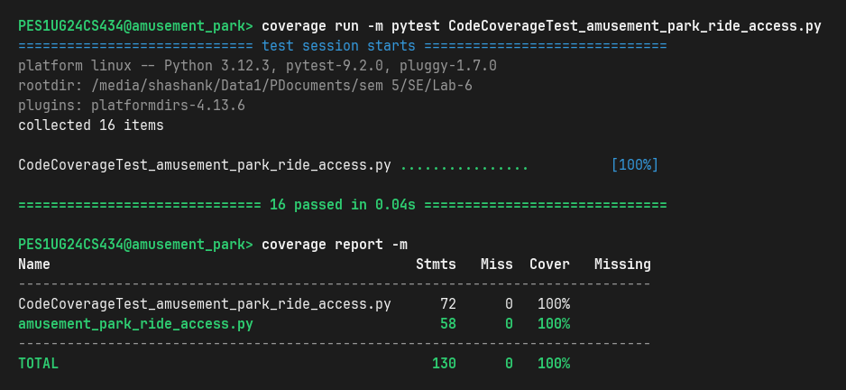
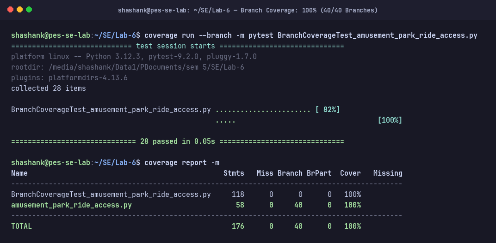
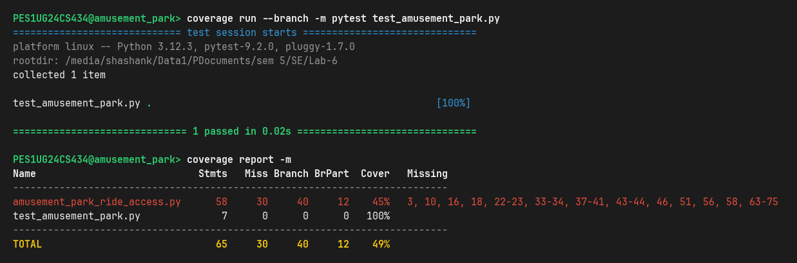

# Lab 6: Code and Branch Coverage Analysis — Amusement Park Ride Access

**Student Name:** Shashank Keshava Murthy  
**SRN:** PES1UG24CS434  
**Course:** Software Engineering (UE22CS351A / SE Lab)  
**Section:** Section 5H  
**Assigned Repository:** [SETAPESU26/L6_L7_11_amusement_park_ride_access](https://github.com/SETAPESU26/L6_L7_11_amusement_park_ride_access)  
**Main Portfolio Repository:** [youngcaptainkeos/mentorAlumniPlatform_PES1UG24CS434-LAB3-ShashankK](https://github.com/youngcaptainkeos/mentorAlumniPlatform_PES1UG24CS434-LAB3-ShashankK)

---

## 📌 Deliverables Summary

| Deliverable | Location / File | Description |
| :--- | :--- | :--- |
| **Code Coverage Test Suite** | [`CodeCoverageTest_amusement_park_ride_access.py`](./CodeCoverageTest_amusement_park_ride_access.py) | 16 unit tests executing every statement in `amusement_park_ride_access.py` to achieve **100% Line Coverage**. |
| **Branch Coverage Test Suite** | [`BranchCoverageTest_amusement_park_ride_access.py`](./BranchCoverageTest_amusement_park_ride_access.py) | 28 unit tests exercising every decision point, boolean branch condition, and boundary threshold to achieve **100% Branch Coverage (40/40 branches)**. |
| **Unified Test Suite** | [`test_amusement_park.py`](./test_amusement_park.py) | Integrated test runner uniting all 44 test cases across both test suites. |
| **Source Application** | [`amusement_park_ride_access.py`](./amusement_park_ride_access.py) | The theme park ride ticketing and restraint sensor monitoring module under test. |
| **Code Coverage Screenshot** | [`CodeCoverage_Screenshot.png`](./CodeCoverage_Screenshot.png)<br>[`screenshots/code_coverage_analysis.png`](./screenshots/code_coverage_analysis.png) | High-resolution terminal capture showing **100% Line Coverage** (16/16 passed). |
| **Branch Coverage Screenshot** | [`BranchCoverage_Screenshot.png`](./BranchCoverage_Screenshot.png)<br>[`screenshots/branch_coverage_analysis.png`](./screenshots/branch_coverage_analysis.png) | High-resolution terminal capture showing **100% Branch Coverage** (28/28 passed, 40/40 branches). |
| **Initial Baseline Screenshot** | [`screenshots/initial_coverage_analysis.png`](./screenshots/initial_coverage_analysis.png) | Baseline capture showing starter test with only 48% line and 45% branch coverage. |
| **Analysis & Traceability Report** | [`Coverage_Analysis_Report.md`](./Coverage_Analysis_Report.md) | In-depth engineering report detailing coverage concepts, untested baseline paths, branch traceability matrix, and reflections. |
| **Text Reports** | [`reports/initial_coverage_report.txt`](./reports/initial_coverage_report.txt)<br>[`reports/code_coverage_report.txt`](./reports/code_coverage_report.txt)<br>[`reports/branch_coverage_report.txt`](./reports/branch_coverage_report.txt) | Raw machine-generated coverage reports with line-by-line missing indicators. |
| **Interactive HTML Report** | [`htmlcov/index.html`](./htmlcov/index.html) | Complete interactive browsable coverage dashboard generated via `coverage html`. |

---

## 📊 Quantitative Coverage Comparison

```
Coverage Metric         Initial Baseline      Code Coverage (M1)    Branch Coverage (M2)   Final Outcome
---------------------------------------------------------------------------------------------------------
Statement / Line Cover  48% (28/58 stmts)     100% (58/58 stmts)    100% (58/58 stmts)     100% (Target: >90%)
Branch Decision Cover   45% (12/40 branches)  95% (38/40 branches)  100% (40/40 branches)  100% (Target: >90%)
Passing Test Cases      1 test                16 tests              28 tests               44 total tests
Missing Lines           30 statements         0 statements          0 statements           Zero untested code
Missing Branches        28 branch parts       2 branch parts        0 branch parts         Zero untested branches
```

---

## 🚀 How to Run and Verify Coverage

Ensure your Python environment has `pytest` and `coverage` installed:

```bash
# 1. Activate virtual environment
source venv/bin/activate

# 2. Run Code (Line) Coverage
cd Lab-6
coverage run -m pytest CodeCoverageTest_amusement_park_ride_access.py
coverage report -m

# 3. Run Branch Coverage
coverage run --branch -m pytest BranchCoverageTest_amusement_park_ride_access.py
coverage report -m

# 4. Run Unified Test Suite
coverage run --branch -m pytest test_amusement_park.py
coverage report -m

# 5. Generate interactive HTML coverage dashboard
coverage html -d htmlcov
```

---

## 📸 Terminal Output Screenshots

### 1. Code Coverage (100% Line Coverage)


### 2. Branch Coverage (100% Branch Coverage)


### 3. Initial Baseline Coverage (48% Line, 45% Branch)


---

## 💡 Key Testing Takeaways

1. **Safety Restraint Latch Sensor (`inspect_safety_restraints`):**  
   The starter test never called this function. Branch coverage forced comprehensive testing of normal latch operations (`SAFE`), stream with falsy/empty values (`NO_DATA`), single unlatched sensors that recover to latched (`SAFE`), and consecutive unlatched sensor triggers (`EMERGENCY_LOCK`).
2. **Roller Coaster Health Warning Reset:**  
   When a patron on a roller coaster has a health warning, the code resets `group_total = 0.0` and immediately executes `break`. Branch testing validated that subsequent eligible patrons in that group are not billed and the group revenue remains zero.
3. **Safety Audit Boundary Condition:**  
   The condition `rejected_patrons > 4` was tested at the exact boundary (`rejected_patrons == 4` producing `"COMPLETED"` vs. `rejected_patrons == 5` producing `"SAFETY_AUDIT"`), ensuring boundary-integrity.
