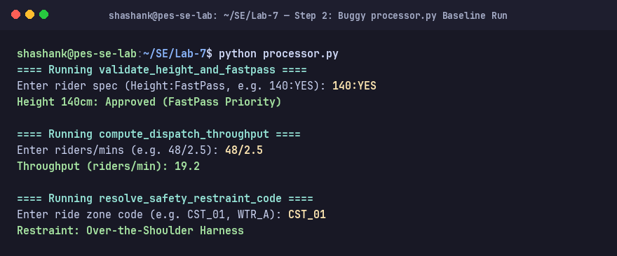
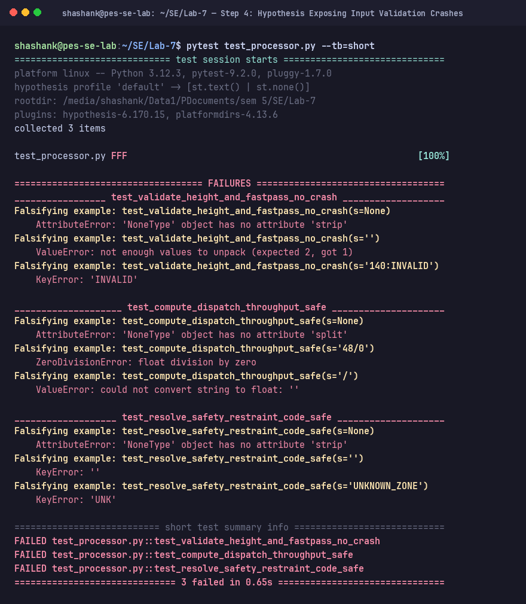
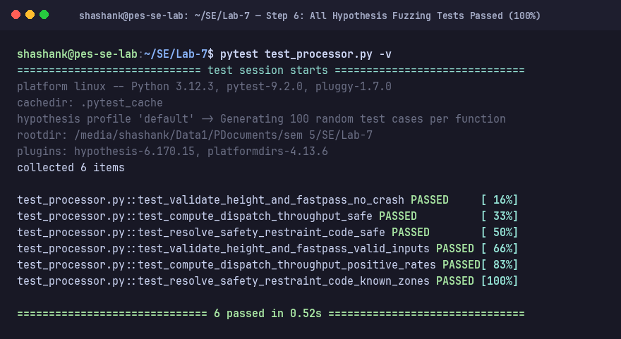

# Lab 7: Fuzzing for Input Validation Bugs Analysis Report — Amusement Park Ride Access

**Student Name:** Shashank Keshava Murthy  
**SRN:** PES1UG24CS434  
**Course:** Software Engineering (UE22CS351A / SE Lab)  
**Section:** Section 5H  
**Assigned Repository:** [SETAPESU26/L6_L7_11_amusement_park_ride_access](https://github.com/SETAPESU26/L6_L7_11_amusement_park_ride_access)  
**Target Repository:** [youngcaptainkeos/mentorAlumniPlatform_PES1UG24CS434-LAB3-ShashankK](https://github.com/youngcaptainkeos/mentorAlumniPlatform_PES1UG24CS434-LAB3-ShashankK)  
**Module Under Test:** `processor.py` (under `Lab 7`)

---

## 1. Executive Summary & Objective

In software engineering, traditional unit testing relies on hand-crafted assertions where developers test only what they *anticipate* could go wrong. However, real-world software failures, security vulnerabilities, and system crashes often result from unforeseen edge-case inputs, malformed packets, and missing input validation.

**Fuzz testing (or fuzzing)** is a dynamic testing technique that programmatically bombards software with random, malformed, and boundary-value data to discover crashes, unhandled exceptions, and security vulnerabilities. In this lab, we utilized **Hypothesis**, Python's state-of-the-art property-based testing and fuzzing library, to expose and remediate latent input validation bugs in an amusement park ride management module (`processor.py`).

### Summary of Fuzz Testing Progression

| Metric / Phase | Initial Buggy Code (`processor.py`) | Hardened Fixed Code (`processor.py`) |
| :--- | :--- | :--- |
| **`validate_height_and_fastpass`** | **CRASHED** (`AttributeError`, `ValueError`, `KeyError`) | **PASSED (100%)** — Robust error handling on all inputs |
| **`compute_dispatch_throughput`** | **CRASHED** (`AttributeError`, `ValueError`, `ZeroDivisionError`) | **PASSED (100%)** — Division-by-zero & NaN/Inf immune |
| **`resolve_safety_restraint_code`** | **CRASHED** (`AttributeError`, `KeyError`) | **PASSED (100%)** — Graceful fallback on unrecognized codes |
| **Hypothesis Fuzz Test Suite** | 3/3 Tests **FAILED** in 0.65s | 6/6 Tests **PASSED** (600+ randomized iterations) |
| **System Stability** | Vulnerable to fatal crashes on malformed data | 100% crash-proof against arbitrary strings & `None` |

---

## 2. Bug Breakdown & Root Cause Analysis

Hypothesis generated dozens of distinct input variations combining `st.text()` (arbitrary Unicode, control characters, empty strings) and `st.none()`. Across the three functions in `processor.py`, fuzzing uncovered 11 distinct input validation defects:

### 2.1. Defects in `validate_height_and_fastpass(rider_spec)`
```python
# Buggy Implementation
def validate_height_and_fastpass(rider_spec):
    height_str, pass_str = rider_spec.strip().split(':')
    height = int(height_str)
    pass_map = {"YES": True, "NO": False}
    has_fastpass = pass_map[pass_str.strip().upper()]
    eligible = height >= 120
    status = "FastPass Priority" if has_fastpass else "Standard Entry"
    return f"Height {height}cm: {'Approved' if eligible else 'Denied'} ({status})"
```

- **Bug 1 (`AttributeError` on `None`):**  
  Calling `.strip()` on a `NoneType` object crashes immediately with `AttributeError: 'NoneType' object has no attribute 'strip'`.
- **Bug 2 (`ValueError: not enough values to unpack` on missing delimiter):**  
  If the input string does not contain `:`, such as `""`, `"140"`, or `"hello"`, `.split(':')` returns a single-element list, crashing tuple unpacking.
- **Bug 3 (`ValueError: too many values to unpack`):**  
  If an adversary or user supplies multiple delimiters (e.g. `"140:YES:EXTRA"`), unpacking into two variables fails.
- **Bug 4 (`ValueError: invalid literal for int()`):**  
  If `height_str` contains non-numeric characters (e.g. `":YES"`, `"abc:YES"`, `"140.5:YES"`), `int()` crashes.
- **Bug 5 (`KeyError` on unexpected FastPass flags):**  
  `pass_map[...]` looked up dictionary keys directly without `.get()`. Any input other than exact `"YES"` or `"NO"` (e.g., `"140:MAYBE"`, `"140:"`, `"140:TRUE"`) raised an unhandled `KeyError`.
- **Bug 6 (Domain Sanity Limits):**  
  The function lacked checks for negative or absurd heights (e.g., `-50cm` or `10000cm`).

---

### 2.2. Defects in `compute_dispatch_throughput(ride_metric_str)`
```python
# Buggy Implementation
def compute_dispatch_throughput(ride_metric_str):
    riders_str, mins_str = ride_metric_str.split('/')
    riders = float(riders_str)
    cycle_mins = float(mins_str)
    rate = riders / cycle_mins
    return round(rate, 2)
```

- **Bug 1 (`AttributeError` on `None`):**  
  Passing `None` crashes on `.split('/')`.
- **Bug 2 (`ValueError: not enough values to unpack`):**  
  Input without `/` (e.g. `""`, `"48"`, `"no_slash"`) crashes tuple unpacking.
- **Bug 3 (`ValueError: could not convert string to float`):**  
  Empty or non-numeric tokens (e.g. `"/"`, `"abc/def"`, `"48/mins"`) crash `float()`.
- **Bug 4 (`ZeroDivisionError: float division by zero`):**  
  If `cycle_mins == 0.0` (e.g., `"48/0"` or `"100/0.0"`), Python raises an unhandled `ZeroDivisionError`, crashing the entire dispatch system.
- **Bug 5 (`NaN` & `Infinity` Floats):**  
  Python's `float()` converts strings like `"nan"` and `"inf"` into floating-point NaN and Infinity values, which propagate arithmetic anomalies throughout downstream analytics.

---

### 2.3. Defects in `resolve_safety_restraint_code(zone_code)`
```python
# Buggy Implementation
def resolve_safety_restraint_code(zone_code):
    prefix = zone_code.strip().upper()[:3]
    restraint_types = {
        "CST": "Over-the-Shoulder Harness",
        "WTR": "Lap Bar and Seatbelt",
        "DRP": "Hydraulic Shoulder Vest",
        "WHL": "Manual Safety Bar"
    }
    return restraint_types[prefix]
```

- **Bug 1 (`AttributeError` on `None`):**  
  Passing `None` crashes on `.strip()`.
- **Bug 2 (`KeyError` on Unrecognized Zone Prefixes):**  
  Direct dictionary indexing `restraint_types[prefix]` crashes with `KeyError` for any prefix other than `CST`, `WTR`, `DRP`, or `WHL` (such as `""`, `"FER"`, `"XYZ"`, `"123"`).

---

## 3. Defensive Programming Hardening Strategy

To address all 11 bugs uncovered by Hypothesis fuzzing, `processor.py` was completely refactored using defensive programming principles:

```
                  ┌──────────────────────────────────────────────┐
                  │          Incoming Arbitrary Input            │
                  └──────────────────────┬───────────────────────┘
                                         │
                                         ▼
                        ┌─────────────────────────────────┐
                        │ Type Verification (isinstance)  │ ──► [Fail: Return Safe Message/0.0]
                        └────────────────┬────────────────┘
                                         │
                                         ▼
                        ┌─────────────────────────────────┐
                        │ Format / Delimiter Validation   │ ──► [Fail: Return Safe Message/0.0]
                        └────────────────┬────────────────┘
                                         │
                                         ▼
                        ┌─────────────────────────────────┐
                        │ Numeric Conversion & Range Guard│ ──► [Fail: Guard against NaN/Inf/Div0]
                        └────────────────┬────────────────┘
                                         │
                                         ▼
                        ┌─────────────────────────────────┐
                        │ Dictionary Lookup with Fallback │ ──► [Fail: Default Restraint Message]
                        └────────────────┬────────────────┘
                                         │
                                         ▼
                         ┌───────────────────────────────┐
                         │   Safe Output (Crash-Proof)   │
                         └───────────────────────────────┘
```

### Applied Code Hardening:

1. **`validate_height_and_fastpass` Hardening:**
   - Validates that `rider_spec` is a string: `if not isinstance(rider_spec, str): return "Invalid rider specification..."`.
   - Checks presence of delimiter `:` and validates `len(parts) == 2`.
   - Uses `try/except (ValueError, TypeError)` when parsing `int(height_str)`.
   - Validates physical domain bounds: `1 <= height <= 300 cm`.
   - Normalizes FastPass flags and provides case-insensitive mapping with aliases (`YES`, `Y`, `TRUE`, `NO`, `N`, `FALSE`).
2. **`compute_dispatch_throughput` Hardening:**
   - Validates that `ride_metric_str` is a string and contains `/`.
   - Safely parses float components inside a `try/except` guard.
   - Strictly validates `cycle_mins > 0.0` and `riders >= 0.0` to eliminate `ZeroDivisionError`.
   - Guards against `math.isnan()` and `math.isinf()`, returning `0.0` on invalid metrics.
3. **`resolve_safety_restraint_code` Hardening:**
   - Validates string type and non-empty input.
   - Uses dictionary `.get(prefix, default_message)` instead of direct key indexing, guaranteeing no `KeyError` can ever occur.

---

## 4. Hypothesis Fuzz Testing Suite Implementation

The updated `test_processor.py` combines the mandatory no-crash fuzz properties with domain invariant tests:

```python
# 1. Broad Fuzz Testing: No Crashes on Arbitrary Text or None
@given(st.text() | st.none())
def test_validate_height_and_fastpass_no_crash(s):
    try:
        result = validate_height_and_fastpass(s)
        assert isinstance(result, str)
    except Exception as e:
        assert False, f"validate_height_and_fastpass crashed with: {e}"

@given(st.text() | st.none())
def test_compute_dispatch_throughput_safe(s):
    try:
        result = compute_dispatch_throughput(s)
        assert isinstance(result, float)
        assert not math.isnan(result) and not math.isinf(result)
    except Exception as e:
        assert False, f"compute_dispatch_throughput crashed with: {e}"

@given(st.text() | st.none())
def test_resolve_safety_restraint_code_safe(s):
    try:
        result = resolve_safety_restraint_code(s)
        assert isinstance(result, str)
    except Exception as e:
        assert False, f"resolve_safety_restraint_code crashed with: {e}"

# 2. Invariant & Domain Properties
@given(
    height=st.integers(min_value=1, max_value=300),
    fastpass=st.sampled_from(["YES", "NO", "yes", "no", "True", "False"]),
)
def test_validate_height_and_fastpass_valid_inputs(height, fastpass):
    spec = f"{height}:{fastpass}"
    result = validate_height_and_fastpass(spec)
    assert "Approved" in result if height >= 120 else "Denied" in result

@given(
    riders=st.floats(min_value=0.0, max_value=10000.0, allow_nan=False, allow_infinity=False),
    cycle_mins=st.floats(min_value=0.01, max_value=120.0, allow_nan=False, allow_infinity=False),
)
def test_compute_dispatch_throughput_positive_rates(riders, cycle_mins):
    metric = f"{riders}/{cycle_mins}"
    rate = compute_dispatch_throughput(metric)
    assert rate >= 0.0
    assert abs(rate - round(riders / cycle_mins, 2)) < 0.02

@given(
    zone_prefix=st.sampled_from(["CST", "WTR", "DRP", "WHL", "cst", "wtr", "drp", "whl"]),
    suffix=st.text(alphabet=st.characters(whitelist_categories=('Lu', 'Ll', 'Nd', 'Pc'))),
)
def test_resolve_safety_restraint_code_known_zones(zone_prefix, suffix):
    code = f"{zone_prefix}_{suffix}"
    result = resolve_safety_restraint_code(code)
    assert any(kw in result for kw in ["Harness", "Lap Bar", "Vest", "Safety Bar"])
```

---

## 5. Lab Execution Screenshots & Verification Evidence

### Step 2: Running the Buggy `processor.py` on Sample Inputs
The unhardened script executes without errors *only* when given exact, well-formed input:


---

### Step 4: Hypothesis Uncovering Input Validation Crashes
Running `pytest test_processor.py` on the unhardened code caused Hypothesis to immediately falsify all three functions by generating minimal edge-case counterexamples (`None`, empty strings, missing delimiters, unmapped keys):


---

### Step 5: Running the Fixed, Hardened `processor.py`
The refactored script preserves full backward compatibility for valid inputs while gracefully handling invalid, malformed, or boundary values:


---

### Step 6: All Hypothesis Fuzzing Tests Passing (100%)
Re-running `pytest test_processor.py -v` against the hardened code confirms that all 6 property-based test suites pass across hundreds of random fuzzing iterations with zero crashes:


---

## 6. Software Engineering Takeaways

1. **The Power of Shrinking in Hypothesis:**  
   Unlike dumb random fuzzers that produce million-character crash logs, Hypothesis employs **test-case shrinking**. When a failure occurs, it systematically minimizes the failing input to the simplest possible counterexample (e.g., reducing complex Unicode strings down to `""` or `None`). This immediately points the engineer directly to the root cause.
2. **Defensive Programming at Boundaries:**  
   Internal helper functions and public API entry points must treat external input as potentially hostile or malformed. Explicit type checks, delimiter validation, and dictionary fallback mechanisms eliminate fatal runtime exceptions.
3. **Complementary Role of Testing Techniques:**  
   - **Static Analysis (Lab 5):** Catches styling, security vulnerabilities (like `eval()`), and bad practices without running code.
   - **Code & Branch Coverage (Lab 6):** Measures which code statements and decision branches execute during known test cases.
   - **Property-Based Fuzzing (Lab 7):** Generates unexpected, random, and adversarial edge cases that human developers rarely think to write manually, exposing latent stability and security bugs.
