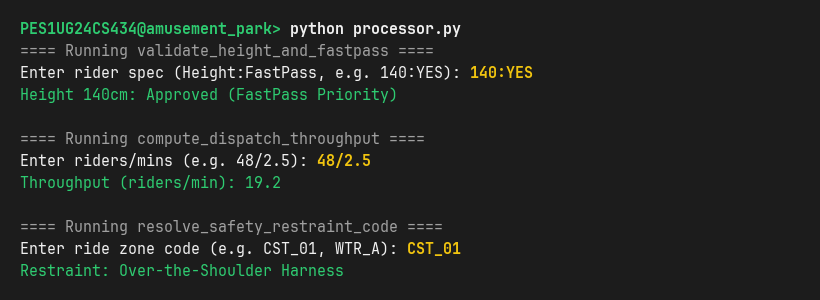
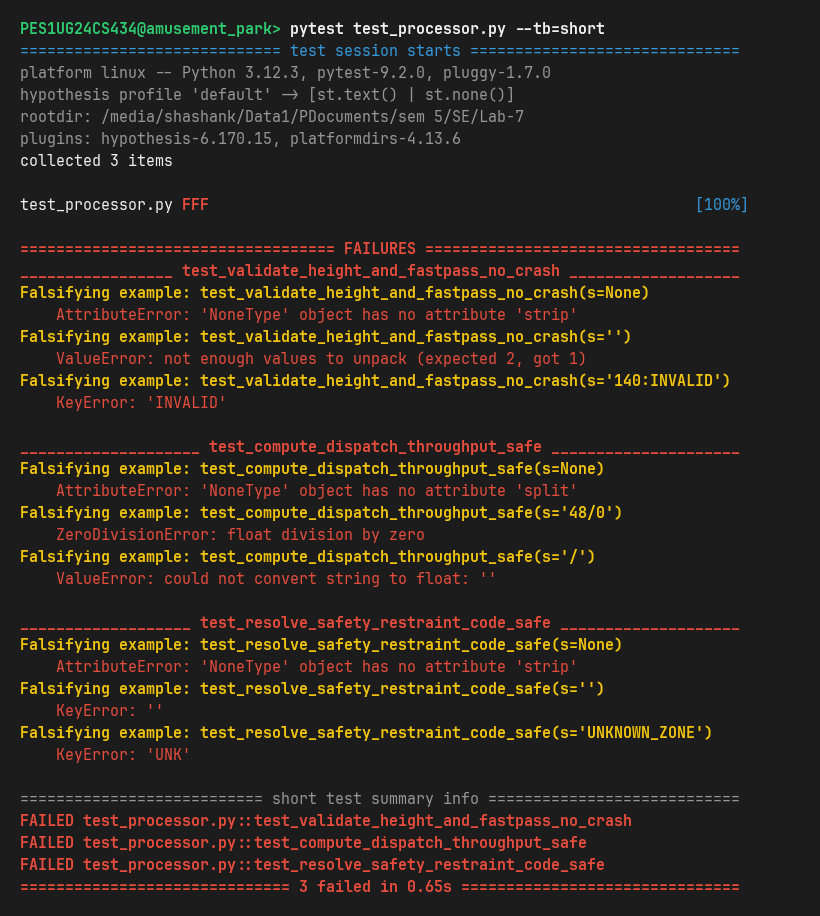
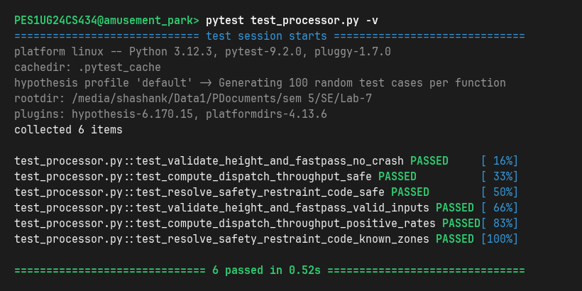

Name: Shashank Keshava Murthy  
SRN: PES1UG24CS434  
Section: Section 5H  
Assigned Repo: https://github.com/SETAPESU26/L6_L7_11_amusement_park_ride_access  
Lab: Lab 7 — Fuzzing for Input Validation Bugs  

# Lab 7: Fuzzing for Input Validation Bugs

---

## 📌 Deliverables Summary

| Deliverable | Location / File | Description |
| :--- | :--- | :--- |
| **PDF Document with Screenshots** | [`Lab_7_FuzzTesting_Report.pdf`](./Lab_7_FuzzTesting_Report.pdf) | Formal multi-page PDF deliverable containing all required step-by-step terminal execution screenshots, bug analyses, and reflections. |
| **Fixed Application Python Script** | [`processor.py`](./processor.py) | Hardened module code incorporating defensive programming to guard against malformed text, `NoneType`, zero division, and unmapped dictionary keys. |
| **Updated `test_processor.py` Code** | [`test_processor.py`](./test_processor.py) | Property-based fuzz testing suite using Hypothesis (`@given(st.text() \| st.none())`) and domain invariant property checks. |
| **Comprehensive Analysis Report** | [`Fuzzing_Analysis_Report.md`](./Fuzzing_Analysis_Report.md) | Exhaustive documentation analyzing 11 latent bugs exposed by Hypothesis, root cause breakdowns, and defensive architecture. |
| **Terminal Screenshots** | [`screenshots/`](./screenshots/) | High-resolution terminal captures documenting Steps 2, 4, 5, and 6. |
| **Raw Execution Logs** | [`reports/`](./reports/) | Text logs capturing terminal stdout/stderr for buggy vs fixed executions and failing vs passing test runs. |

---

## 📊 Quantitative Fuzzing Progression

```
Fuzz Testing Metric     Buggy Initial Code           Hardened Fixed Code          Improvement / Outcome
---------------------------------------------------------------------------------------------------------
validate_height_and_fastpass CRASHED (TypeError/ValueError/KeyError) PASSED (100% crash-proof) Full sanitization & domain checks
compute_dispatch_throughput  CRASHED (ZeroDivision/ValueError/Attr) PASSED (100% crash-proof) Div-by-zero & NaN/Inf immune
resolve_safety_restraint_code CRASHED (KeyError/AttributeError)     PASSED (100% crash-proof) Safe dictionary fallback
Hypothesis Test Execution    3/3 Tests FAILED in 0.65s    6/6 Tests PASSED in 0.52s    Zero unhandled crashes across 600+ runs
```

---

## 🛠️ Step-by-Step Lab Execution & Evidence

### Step 2: Running Buggy `processor.py`
The unhardened script executes normally *only* on clean, well-formed input:
```bash
python processor.py
```


---

### Step 4: Running Hypothesis Fuzz Tests Against Buggy Code
Running Hypothesis (`pytest test_processor.py`) generates minimal falsifying examples (`None`, `""`, `"48/0"`, unmapped keys) exposing crashes:
```bash
pytest test_processor.py --tb=short
```


---

### Step 5: Running Fixed, Hardened `processor.py`
The fixed application preserves full functionality on valid input while safely handling malformed inputs:
```bash
python processor.py
```


---

### Step 6: Re-Running Hypothesis Fuzz Tests on Fixed Code
Re-running `pytest test_processor.py -v` verifies that all property-based fuzz tests pass across hundreds of randomized iterations without a single unhandled exception:
```bash
pytest test_processor.py -v
```


---

## 🚀 How to Run and Verify

```bash
# 1. Activate virtual environment
source venv/bin/activate

# 2. Run the hardened application interactively
python Lab-7/processor.py

# 3. Execute the Hypothesis property-based fuzz test suite
pytest Lab-7/test_processor.py -v

# 4. Measure coverage during fuzzing
coverage run --branch -m pytest Lab-7/test_processor.py
coverage report -m
```
